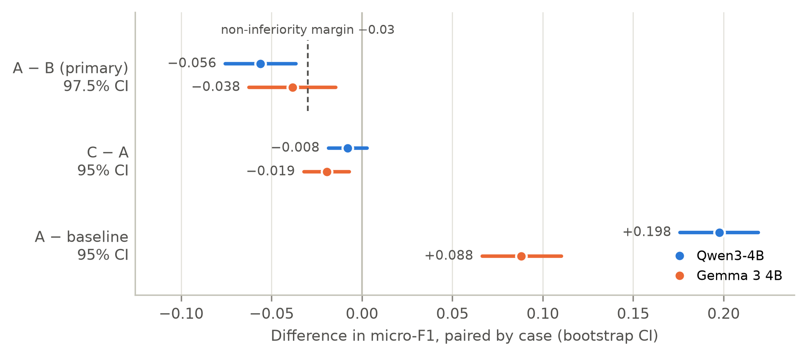
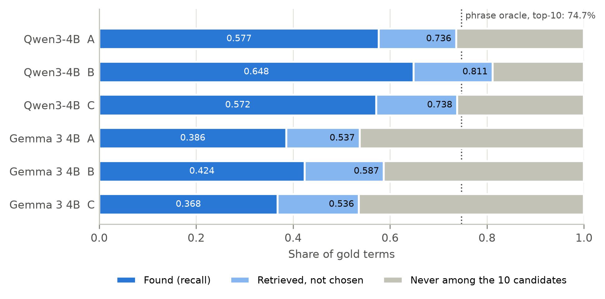
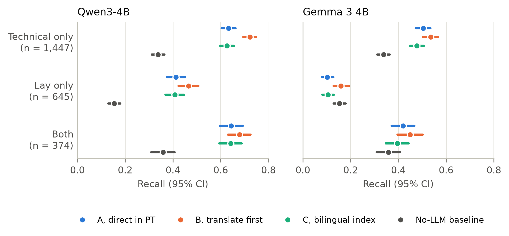

<!-- Generated by paper/build_manuscript.py from results/; do not edit by hand. -->

# Brazilian Portuguese phenotype text and the Human Phenotype Ontology: translation coverage, cross-lingual retrieval and extraction with small local language models

*Provisional title. Draft for medRxiv (Health Informatics) or arXiv (cs.CL).*

**R. Walitte** (Rondinelle Walitte Pedro de Jesus)1 · ORCID [0009-0004-1776-2754](https://orcid.org/0009-0004-1776-2754)
**[Clinical co-author: name, affiliation, ORCID. TODO]**2

1 Independent researcher. [TODO: city, country.] 2 [TODO.]
Corresponding author: R. Walitte, rondinellewalitte@gmail.com

> Research support only. Nothing in this work is a clinical or diagnostic tool or should guide patient care. Only public data and synthetic text were used; no patient data.

## Abstract

**Background:** Tools extracting Human Phenotype Ontology (HPO) terms from clinical text are built for English, and only 36.0% of active HPO terms have an official Portuguese label. We measured the consequences for Brazilian Portuguese.

**Methods:** Three experiments followed analysis plans time-stamped in git before any results existed. Experiment 1 searched 6,976 official Portuguese labels in an English-only index with embedding models and a lexical baseline. Experiment 2 measured label coverage in 10,374 Phenopacket Store cases. In Experiment 3, a large language model (LLM) wrote 300 synthetic Brazilian Portuguese vignettes from published cases; two local LLMs (Qwen3-4B, Gemma 3 4B) extracted findings directly in Portuguese (A) or after translation to English (B), against a no-LLM baseline. The primary outcome was micro-F1, A versus B.

**Results:** In Experiment 1, bge-m3 ranked the correct term first for 81.2% of labels. In Experiment 2, official labels covered 38.3% of case annotations and 5.8% of cases fully. In Experiment 3, translating first scored higher: F1(A) − F1(B) was −0.056 (97.5% CI −0.076 to −0.036) for Qwen3-4B and −0.038 (−0.062 to −0.015) for Gemma 3 4B, so non-inferiority was not shown. Adding Portuguese labels to the index did not help, and hurt Gemma 3 4B. The correct term was among retrieved candidates for 73.6% and 53.7% of gold terms, and lay-only descriptions were recalled at 0.412 and 0.102.

**Conclusions:** On synthetic text, retrieval and lay wording limited small local models more than the extraction language did. The translate-first advantage needs testing on real Brazilian clinical notes.

**Keywords:** Human Phenotype Ontology; Brazilian Portuguese; rare diseases; phenotype extraction; large language models; cross-lingual retrieval

## Introduction

Rare diseases are individually uncommon but together affect an estimated 3.5–5.9% of the population [1]. Their diagnosis depends on precise phenotyping, and the Human Phenotype Ontology (HPO) is the standard vocabulary for it [2–4]. HPO terms feed phenotype-driven prioritization of genes and diseases [5,6], and case-level descriptions are exchanged as GA4GH Phenopackets [7], of which Phenopacket Store is a large public collection [8]. In Brazil, a national rare-disease network is collecting clinical data with international ontologies [9].

Clinicians write free text, so HPO terms must be extracted from notes. Concept recognizers such as ClinPhen and PhenoTagger [10,11], general LLMs [12] and LLMs combined with retrieval, as in RAG-HPO [13], were developed and evaluated on English text. LLMs have also been benchmarked for diagnosis from phenopacket-derived prompts [14]. [TODO: the multilingual vignettes derived from Phenopacket Store (phenopacket2prompt, Zenodo 10.5281/zenodo.14907503) cover ten languages but not Portuguese; that DOI is registered with DataCite, not Crossref, so it is not yet cited.] Clinical language processing in other languages has fewer resources [15]. Brazilian Portuguese has a semantically annotated clinical corpus, annotated with UMLS rather than HPO [16], and clinical language models [17].

The HPO has community translations, and its browser shows labels in ten languages besides English [4]; English also has plain-language synonyms for lay descriptions [18]. The official Portuguese file of release v2026-09-01 has labels for 7,154 of 19,894 active terms (36.0%), and 7,213 of its 7,214 rows are labels (the other is a definition), so it has no synonyms. A Portuguese note can be mapped directly, with multilingual retrieval and models, or translated to English first. Which works better, and how much the incomplete translation limits either route, has not been measured.

We report three analyses, each with a plan written before its results existed:

1. **Experiment 1:** can an official Portuguese label be mapped to its HPO term by searching English text only?
2. **Experiment 2:** how much of the phenotype annotation of published rare-disease cases already has an official Portuguese label, and which missing terms matter most?
3. **Experiment 3:** on synthetic Brazilian Portuguese clinical vignettes, does a small LLM running locally extract HPO terms as well directly in Portuguese as after translating to English? Does adding the Portuguese labels to the index help, and how much does the LLM add to a retrieval-only baseline?

Whether extraction errors change the ranking of candidate genes or diseases is outside the scope of this work.

## Methods

### Pre-specification, deviations and reproducibility

For each experiment, hypotheses, outcomes and analysis rules were written in a pre-specification file (`results/exp0N/PREREG.md`) and committed to the project's git repository before any of its results were computed (Experiments 1 and 2) or any vignette was generated (Experiment 3); the structural counts seen beforehand are listed in each file. Later changes were only appended, dated, to a "Deviations" section. The plans were not deposited in an external registry. The git timestamps are the only record of their order, and the repository became public only after each experiment's results existed (see Limitations). We use "pre-specified" for what was in these files from the start, "amendment" for dated changes made before the affected data or results existed, and "post hoc" for analyses defined after results were seen. The three files list 5, 3 and 22 dated entries, all summarized in Supplementary Table S1.

Every number, table and figure in this manuscript is generated by `paper/build_manuscript.py` from the result files of release v0.2.1, which stops if those files differ from the tagged release. The Experiment 1 and 2 results are identical to those of release v0.1.0, which the same check verifies.

### Data

We used HPO release v2026-09-01 (`hp.json`, `phenotype.hpoa` and the Portuguese translation file `hp-pt.babelon.tsv` of the same tag) and Phenopacket Store 0.1.27 [8]. HPO v2026-09-01 has 19,894 active terms, 19,177 of them under Phenotypic abnormality (HP:0000118). Of the official Portuguese labels of active terms, 227 translate an earlier version of the English label. Files were downloaded by script and their SHA-256 hashes recorded in each experiment's `config.json`.

### Experiment 1: cross-lingual normalization of official labels

The queries were the 7,154 official Portuguese labels of active terms; the 6,976 under HP:0000118 formed the primary scope. The index held only English text: the label and exact synonyms of all 19,894 active terms (42,581 texts). We compared bge-m3 [19], multilingual-e5-base with two prefix schemes, paraphrase-multilingual-mpnet-base-v2 [20] (revisions in `results/exp01/config.json`) and a lexical baseline (rapidfuzz token-sort ratio on case- and accent-folded text). A term's score was the maximum over its texts, and ties counted against a hit. The primary outcome was top-1 accuracy; pairwise differences were tested with exact McNemar tests [21] and Holm correction over four pre-specified comparisons. The 8 hypotheses in Table 1 were fixed in advance. Post-hoc analyses, all labeled as such below, classified top-1 errors by their hierarchical relation to the correct term, counted hand/foot swaps and weighted accuracy by how often each term is used in Phenopacket Store. Accuracy intervals are Wilson intervals, which treat the queries as independent; HPO terms are hierarchically related and whole families share wording, so the intervals on absolute accuracy are narrower than that dependence warrants. The comparisons between methods are paired on the same queries and are unaffected.

### Experiment 2: translation coverage in published cases

The terms of a case were its observed phenotypic features (excluded features did not count), resolved to current primary IDs and counted once per case. Of 10,377 phenopackets, 3 had no observed term and were excluded. A term counted as translated if it had an official Portuguese label. Outcomes were annotation coverage (case–term pairs), the share of fully covered cases and the distribution of per-case coverage, plus a ranked list of untranslated terms by number of cases. The 5 descriptive expectations in Table 1 were written in advance, without tests. Post-hoc checks estimated the coverage gain from translating the k most frequent missing terms out of sample: the list was ranked on half of the genes and evaluated on the other half (seed 42; spread over 20 other seeds). A second list was ranked by the number of annotated diseases in `phenotype.hpoa`.

### Experiment 3: extraction from synthetic Portuguese vignettes

**Cases.** Eligible cases had 3 to 15 observed terms under HP:0000118 (7,770 cases, 632 genes). With a fixed seed, one case was drawn per gene; the first 50 genes formed the pilot, the next 300 the full set and the rest a reserve, with no gene shared between sets. The gold standard was the observed terms; up to 5 excluded terms per case, other than ancestors or descendants of an observed term, were stated as absent in the text and counted as false positives if extracted. The full set had 2,466 gold terms and 959 stated negations.

**Vignettes.** `claude-opus-5-5` (Anthropic API, effort "low") wrote each vignette as a Brazilian first-visit history from the patient's sex and age and the English label and definition of each item; it saw no HPO ID, disease, gene or publication. The prompt asked for each item in Brazilian clinical language, mixing lay and technical wording, nothing clinical beyond the items, and the exact phrase expressing each item. An automatic check rejected a vignette containing an HPO or disease ID, the gene symbol or an English label, or with fewer than 3 present items left; by amendment, an item without a verbatim phrase in the text left the gold standard instead of failing the vignette (no item was dropped in the full set). A label counted as English only if it was not part of an official Portuguese label and contained a spelling impossible in Portuguese, so that Greco-Latin cognates passed (an amendment; Supplementary Table S1). A case failing twice would be replaced from the reserve; after the amendments in Supplementary Table S1, all 300 drawn cases of the full set were kept. The API no longer accepts sampling parameters, so reproducibility rests on the fixed model, versioned prompts and stored outputs, which are reused and never regenerated. Generation cost was capped at US$ 12 cumulative; the full set took 308 calls (US$ 7.12), and Experiment 3 spent US$ 9.60 in total. The generator was never used as an extractor.

**Arms.** Two local models ran through Ollama 0.40.11: `qwen3:4b-instruct-2507-q4_K_M` (digest 0edcdef34593) and `gemma3:4b-it-q4_K_M` (digest 68ceab7e468a), with temperature 0, seed 42 and a 4,096-token context; extraction and selection outputs were constrained by JSON schemas. In arm A, the LLM listed present and absent findings in Portuguese; each present finding was embedded with `BAAI/bge-m3` and the 10 closest terms were retrieved from an English index (label and exact synonyms of the 19,177 terms under HP:0000118, 41,466 texts); the LLM then chose one candidate or none, constrained to the 10 IDs. In arm B, the same LLM first translated the vignette to English and the same steps followed. Arm C reused A's findings but searched a bilingual index that added the 6,976 official Portuguese labels. The selector always saw the finding and each candidate's ID and English label. The baseline split the Portuguese text into clauses, took the top-1 term of each clause from the English index and kept it if its score was at least τ, with no negation handling. Prompts were identical for both models.

**Outcomes and hypotheses.** The primary outcome was micro-averaged F1 over terms with exact ID match, compared between A and B within each model and paired by case. Intervals came from a case bootstrap (10,000 resamples, percentile method) [22]. H1, the primary hypothesis, stated non-inferiority of A: the lower limit of the 97.5% CI of F1(A) − F1(B) (Bonferroni over two models) above −0.03 in both models; if the interval excluded zero, superiority in either direction would be reported. Secondary hypotheses H2–H6 (Table 1) used 95% CIs without adjustment. Because H1 was to be confirmed only if it held in both models — an intersection–union rule, which already controls the type-I error at the nominal level — the Bonferroni widening to 97.5% was not required; for a non-inferiority margin it widens the interval in the direction that makes non-inferiority easier to reject, so it is the less cautious choice for the superiority we end up reporting. The conclusion does not depend on it: both point estimates (−0.056 and −0.038) and both 95% lower limits (−0.073 and −0.059) also fall below the −0.03 margin. Intervals are percentile intervals of a ratio of sums; bias-corrected and accelerated intervals were not computed. Diagnostics included the retrieval ceiling (the share of gold terms among the candidates of any finding), the selection loss (ceiling minus recall) and a phrase oracle (the generator's own phrase searched with bge-m3, without an LLM).

**Back-translation strata.** The generator wrote from English labels, so translating back could recover them artificially. Each gold term was stratified by surface similarity between its Portuguese phrase and its English label (rapidfuzz ratio, bands < 50, 50–80, ≥ 80), and by whether the phrase equalled the official Portuguese label. These bands are not independent of the clinical register below: a finding written in lay words is far from the English label by construction. The two were therefore crossed, post hoc, so that the similarity reading could be told apart from the register reading.

**Clinical register.** Before any full-set extraction, each gold item was labeled as written in technical terms only, lay terms only or both (stratum D2). Labels came from independent Claude Code subagents (`claude-opus-5-5`), blind to a rule-based classification and to any extraction, in batches that each repeated the same calibration cases. The author, who is not a clinician, labeled 40 pilot items, stratified by the labeler's class (14 technical only, 13 lay only, 13 both), without seeing the labeler's answer. Cohen's kappa [23] was 0.85 (95% CI 0.70 to 0.96), above the 0.6 threshold, set by amendment before any extraction, for treating D2 as confirmatory. Agreement with the pilot labels on the repeated calibration items ranged from 84% to 100% across batches. H6 and expectations E6–E8 on these strata were added by amendment before any extraction. A literal, rule-based stratum (D1) is reported descriptively.

**Pilot and freezing.** The pilot (50 cases, both models, all arms) measured time and memory and set τ = 0.70, the value maximizing pilot micro-F1 on a grid from 0.30 to 0.95. The extraction prompts were not changed after the pilot; prompts, τ and models were frozen before the full set, which refused to run with uncommitted code. Pilot numbers enter no hypothesis.

### Software and compute

Analyses used Python 3.12.14. Embeddings and local LLMs ran on a laptop GPU with 6 GB of memory (NVIDIA GeForce RTX 3050 6GB Laptop GPU); the run was staged so that the LLM and the embedding model never shared the GPU. Peak memory use of the whole GPU, display included, was 4,674 MiB, and the full Experiment 3 run took 4.1 h for 13,678 model calls.

## Results

### Primary outcomes and pre-specified hypotheses

Table 1 lists every pre-specified hypothesis and expectation with its outcome: 4 of 8 hypotheses held in Experiment 1, 4 of 5 expectations in Experiment 2, and 2 of 6 hypotheses in both models in Experiment 3 (H3, H6).

**Table 1.** Pre-specified hypotheses (Experiments 1 and 3) and expectations (Experiment 2). H4 and H5 are conjunctions, so the last column names which criterion held; in both, the criterion about arm A held and the one about the comparator did not. Sources: `results/exp01/hypotheses.json`, `results/exp02/expectations.json`, `results/exp03/hypotheses.json`.

| Exp | Pre-specified statement | Held | Criteria |
|---|---|---|---|
| 01 | H1: Top-1 ordering bge-m3 > e5 > mpnet > lexical (each pair, Holm-adjusted McNemar) | No | – |
| 01 | H2: Identical cognates: every method top-1 ≥ 0.85 | Yes | – |
| 01 | H3: Non-identical labels: lexical top-1 ≤ 0.40 and best embedding ≥ 30 points below its identical-cognate top-1 | No | – |
| 01 | H4: Best embedding: top-10 − top-1 ≥ 15 points | No | – |
| 01 | H5: Labels translating an outdated English label: lower top-1 than current ones | Yes | – |
| 01 | H6: Adding related/broad/narrow synonyms changes top-1 by ≤ 3 points, never upwards | Yes | – |
| 01 | H7: e5 with query/query prefixes ≥ query/passage | No | – |
| 01 | H8: Best embedding: near-misses ≥ 20% of top-1 errors | Yes | – |
| 02 | E1 (expectation, no test): Annotation coverage between 40% and 60% | No | – |
| 02 | E2 (expectation, no test): At most 10% of cases fully covered | Yes | – |
| 02 | E3 (expectation, no test): Median per-case coverage between 0.35 and 0.65 | Yes | – |
| 02 | E4 (expectation, no test): Translating the 300 most frequent missing terms adds ≥ 15 points of annotation coverage (in sample) | Yes | – |
| 02 | E5 (expectation, no test): phenotype.hpoa figures close to the project's prior notes (tolerance set post hoc) | Yes | – |
| 03 | H1 (primary): A non-inferior to B, lower 97.5% CI limit of F1(A) − F1(B) > −0.03 | No (Qwen3-4B no; Gemma 3 4B no) | – |
| 03 | H2: C better than A (95% CI > 0), gain ≤ 0.05 | No (Qwen3-4B no; Gemma 3 4B no) | C − A > 0 with 95% CI above 0: no (−0.008, −0.019); gain ≤ 0.05: yes |
| 03 | H3: F1(A) − F1(baseline) ≥ 0.05, 95% CI > 0 | Yes (Qwen3-4B yes; Gemma 3 4B yes) | A − baseline ≥ 0.05: yes (0.198, 0.088); 95% CI above 0: yes |
| 03 | H4: negation false-positive rate ≤ 0.10 in A and ≥ 0.25 in the baseline | No (Qwen3-4B no; Gemma 3 4B no) | A ≤ 0.10: yes (0.049, 0.069); baseline ≥ 0.25: no (0.114) |
| 03 | H5: in A, retrieval ceiling ≥ 0.75 and selection loss ≥ 0.10 | No (Qwen3-4B no; Gemma 3 4B no) | ceiling ≥ 0.75: no (0.736, 0.537); selection loss ≥ 0.10: yes (0.159, 0.151) |
| 03 | H6 (added before extraction): technical-only recall > lay-only recall in every arm and the baseline | Yes (Qwen3-4B yes; Gemma 3 4B yes) | – |

**Experiment 1.** Searching English text only, bge-m3 ranked the correct term first for 81.2% (95% CI 80.2% to 82.1%) of the 6,976 labels, against 54.1% for the lexical baseline (Table 2). bge-m3 exceeded e5 by 8.8 percentage points (Holm-adjusted p < 0.001), but mpnet scored 2.1 percentage points below the lexical baseline, so the pre-specified ordering (H1) failed. The top-10 − top-1 gap for bge-m3 was 13.8 points, below the 15 of H4, and e5 scored higher with query/passage prefixes than with the query/query scheme expected by H7.

**Table 2.** Experiment 1: top-1 and top-10 accuracy of official Portuguese labels searched against an English-only index (primary scope, n = 6,976; ties count against a hit). Sources: `results/exp01/metrics.json`, `results/exp01/surface_sim.json`.

| Method | Top-1 (95% CI) | Top-10 | Top-1, surface similarity < 50 (n = 3,139) |
|---|---|---|---|
| bge-m3 | 81.2% (80.2% to 82.1%) | 95.0% | 73.6% |
| multilingual-e5-base (query/query, primary) | 72.4% (71.3% to 73.4%) | 91.6% | 62.2% |
| multilingual-e5-base (query/passage) | 74.7% (73.6% to 75.7%) | 92.6% | 65.0% |
| paraphrase-multilingual-mpnet-base-v2 | 52.0% (50.9% to 53.2%) | 78.9% | 47.1% |
| Lexical baseline (token sort ratio) | 54.1% (52.9% to 55.3%) | 73.0% | 39.8% |

**Experiment 2.** In 10,374 cases with 92,068 observed annotations, 38.3% of annotations had an official Portuguese label, below the 40–60% range of expectation E1. Only 5.8% of cases were fully covered and 13.1% had no translated term; the median per-case coverage was 0.36. In `phenotype.hpoa`, 40.3% of disease annotations and 193 of the 500 terms annotated to the most diseases had a Portuguese label.

**Experiment 3.** Table 3 gives precision, recall and F1 per arm. Translating first gave the highest F1 for both models. F1(A) − F1(B) was −0.056 (97.5% CI −0.076 to −0.036) for Qwen3-4B and −0.038 (97.5% CI −0.062 to −0.015) for Gemma 3 4B (Figure 1). Both lower limits fell below the −0.03 margin, so H1 was not supported. Both intervals excluded zero, so, as pre-specified, we report B as superior to A in both models.

**Table 3.** Experiment 3: extraction from 300 synthetic vignettes (2,466 gold terms, 959 stated negations). Micro scores pool all terms; macro scores average per case. Source: `results/exp03/metrics.json`.

| Model | Arm | Precision | Recall | Micro-F1 | Macro-F1 | Stated negations predicted as present (95% CI) | Seconds per case, median |
|---|---|---|---|---|---|---|---|
| Qwen3-4B | A, direct in Portuguese | 0.482 | 0.577 | **0.525** | 0.527 | 4.9% (3.4% to 6.5%) | 10.9 |
| Qwen3-4B | B, translate first | 0.527 | 0.648 | **0.582** | 0.588 | 3.2% (2.0% to 4.6%) | 15.0 |
| Qwen3-4B | C, bilingual index | 0.472 | 0.572 | **0.517** | 0.523 | 4.9% (3.4% to 6.5%) | 10.9 |
| Gemma 3 4B | A, direct in Portuguese | 0.451 | 0.386 | **0.416** | 0.412 | 6.9% (5.3% to 8.6%) | 6.9 |
| Gemma 3 4B | B, translate first | 0.489 | 0.424 | **0.454** | 0.453 | 5.5% (3.9% to 7.3%) | 11.0 |
| Gemma 3 4B | C, bilingual index | 0.430 | 0.368 | **0.396** | 0.393 | 6.7% (5.1% to 8.5%) | 7.0 |
| – | No-LLM baseline (τ = 0.70) | 0.372 | 0.293 | **0.328** | 0.303 | 11.4% (9.3% to 13.5%) | 0.2 |

**Figure 1.** Paired differences in micro-F1 between arms, by model. The primary comparison (A − B) shows the pre-specified 97.5% CI and the non-inferiority margin; the others show 95% CIs. Case bootstrap, 10,000 resamples. Source: `results/exp03/metrics.json` → `comparisons`.

The bilingual index did not improve on A: F1(C) − F1(A) was −0.008 (95% CI −0.018 to 0.003) for Qwen3-4B and −0.019 (95% CI −0.032 to −0.007) for Gemma 3 4B, so H2 was not supported; for Gemma 3 4B the whole interval lies below zero, so C was worse than A. Both LLM pipelines beat the no-LLM baseline (H3): F1(A) − F1(baseline) was +0.198 (95% CI 0.176 to 0.219) for Qwen3-4B and +0.088 (95% CI 0.067 to 0.110) for Gemma 3 4B. H4 failed on its second criterion: in arm A, 4.9% and 6.9% of the stated negations were predicted as present (criterion ≤ 10%), but the baseline rate was 11.4%, not ≥ 25%. H5 failed on the retrieval ceiling. H6 held: technical-only terms were recalled better than lay-only terms in every arm and in the baseline.

### Secondary and exploratory analyses

**Experiment 1.** Where the Portuguese label is spelled far from the English text (surface similarity < 50, n = 3,139), bge-m3 reached 73.6% top-1 against 39.8% for the lexical baseline (Table 2). Labels translating an outdated English label scored lower than current ones (76.2% vs 81.3%, n = 227; H5). Near-misses, where the top term is a direct parent or child of the correct one, were 21.1% of top-1 errors (H8). Post hoc, 47.6% of bge-m3 top-1 errors were hierarchically distant from the correct term, and 7.4% swapped hand and foot, as in "toe" for "finger". Weighting each term by its number of Phenopacket Store cases (post hoc) gave a bge-m3 top-1 of 81.7% (95% CI 76.5% to 86.1%).

**Experiment 2.** The most frequent untranslated terms were common neurodevelopmental findings (Supplementary Table S2); the first, Global developmental delay, appears in 25.3% of cases. Translating the 50 most frequent missing terms would raise annotation coverage to 62.9% in sample. Post hoc, out of sample, the gain was +22.3 pp on average (range +19.5 pp to +24.4 pp), and a list ranked independently by `phenotype.hpoa` reached 60.1% (Table 4).

**Table 4.** Experiment 2: annotation coverage of official Portuguese labels in Phenopacket Store 0.1.27, and simulated coverage if the k most frequent missing terms were translated (k = 50, 100, 300). Sources: `results/exp02/metrics.json`, `results/exp02/out_of_sample.json`.

| Translated terms added | Annotation coverage, in sample | Gain out of sample, mean (min–max) [post hoc] | Annotation coverage, list ranked by phenotype.hpoa [post hoc] | Cases fully covered, in sample |
|---|---|---|---|---|
| 0 (official labels today) | 38.3% | – | – | 5.8% |
| 50 most frequent missing | 62.9% | +22.3 pp (+19.5 pp to +24.4 pp) | 60.1% | 14.2% |
| 100 most frequent missing | 70.7% | +29.0 pp (+26.5 pp to +31.6 pp) | 67.5% | 21.9% |
| 300 most frequent missing | 84.6% | +41.1 pp (+38.4 pp to +43.4 pp) | 79.5% | 42.8% |

**Experiment 3: where terms are lost.** In arm A, the correct term was among the 10 candidates of some finding for only 73.6% of gold terms with Qwen3-4B and 53.7% with Gemma 3 4B, and the selection step lost a further 15.9% and 15.1% (Figure 2). With the generator's own phrase and no LLM, bge-m3 placed the correct term first for 49.5% and in the top 10 for 74.7% of gold terms. For comparison, clean official labels reached 95.0% top-10 in Experiment 1. This cross-experiment comparison is descriptive, and the Experiment 3 index was smaller (terms under HP:0000118 only), which should make its task easier. Near-misses were 18.1% and 18.5% of false positives in arm A (E2), and hand/foot swaps 0.1% and 0.0% (E3). Qwen3-4B answered "none" for 6.7% of findings in arm A and Gemma 3 4B for 0.1%.

**Figure 2.** Share of gold terms found (recall), retrieved among the 10 candidates but not chosen, and never retrieved, by model and arm. The number at the right end of the light segment is the retrieval ceiling. The dotted line is the phrase oracle (generator phrase, bge-m3, top-10, no LLM). Source: `results/exp03/metrics.json` → `arms`, `oracle_spans_bge_m3_en_index`.

**Back-translation strata.** Most gold phrases were far from their English label (1,894 below 50, 472 from 50 to 80 and 100 at 80 or above). B's advantage was largest in the lowest band (recall A − B: −0.083 and −0.056) and absent at 80 or above (+0.010 and +0.070). Literal recovery of the English source label would predict the opposite pattern. The generator used the official Portuguese label as the phrase for 199 of 2,466 gold terms (975 gold terms had such a label). Source: `results/exp03/metrics.json` → `recall_by_stratum`. Because the bands and the register are correlated (Cramér's V = 0.23; 642 of the 645 lay-only terms sit in the lowest band, and none above 80), we crossed them post hoc. Within technical-only terms alone, B's advantage still fell as similarity rose: recall A − B was −0.119 and −0.060 at < 50, against +0.025 and +0.037 at 80 or above, so the gradient is not an artifact of register. Source: `results/exp03/strata_cross.json`.

**Clinical register.** Of the 2,466 gold items, 1,447 were technical only, 645 lay only and 374 both. Lay-only recall in arm A was 0.412 for Qwen3-4B and 0.102 for Gemma 3 4B, against 0.633 and 0.504 for technical-only terms (Figure 3). For Gemma 3 4B, lay-only recall in A fell below the no-LLM baseline (0.153). Translating first raised lay-only recall by 0.053 and 0.057 (95% CI 0.015 to 0.091 and 0.026 to 0.089). The A–B gap was larger for lay-only than for technical-only terms in Gemma 3 4B (E6). The bilingual index did not gain more on technical-only terms (E7: neither model), and the baseline's drop from technical to lay was not larger than A's (E8: neither model).

**Figure 3.** Recall by clinical register of the gold term (D2), by arm and model, with 95% case-bootstrap CIs. The baseline does not use an LLM and is the same in both panels. Source: `results/exp03/metrics.json` → `register.d2`.

**Other expectations and post-hoc analyses.** Micro-F1 of arm A fell within the expected 0.35–0.65 range in both models (E1). The time expectation (E4: median ≤ 30 s per case in A and B at least 1.5 times slower) held for Gemma 3 4B. Recall was higher for terms with an official Portuguese label in both models (E5). Post hoc, recall by top-level HPO branch is given in Supplementary Table S3. The branch with the most gold terms was Abnormality of the nervous system (n = 773); Gemma 3 4B in arm A had its lowest recall in Abnormality of the digestive system (0.188).

## Discussion

Across three analyses, the language of the input was not the main obstacle to mapping Brazilian Portuguese text to the HPO. Experiment 1 showed that a multilingual embedding model finds most clean Portuguese labels in an English-only index. In Experiment 3, the losses came from retrieval and from lay wording.

**Retrieval was the bottleneck.** Even with a perfect choice step, 26.4% of gold terms with Qwen3-4B and 46.3% with Gemma 3 4B were never among the candidates in arm A. The phrase oracle shows that this is not only an LLM problem: with the generator's own phrases, bge-m3 missed the top 10 for 25.3% of terms, against 5.0% for clean labels in Experiment 1, although its index was smaller here. Free-text descriptions sit further from HPO labels than translated labels do. Improving what is searched and how, through more synonyms, lay phrasing or candidate reranking, may matter more than a larger extractor. This study did not test any of these.

**"Translate first" won on synthetic vignettes, and that may not transfer.** The pre-specified hypothesis was that direct extraction would be non-inferior; instead translation helped both models. The back-translation strata argue against the simplest artifact, recovery of the English source label: the gain was largest where the Portuguese phrase was least like that label, and that gradient survives inside the technical-only register, where it cannot be a by-product of lay wording. A subtler artifact remains possible. An LLM wrote the vignettes from English material, and its Portuguese may follow English structure that a translator easily maps back. Real Brazilian notes, with abbreviations, local expressions and typing errors, may behave differently, so this result supports testing the translate-first route on real text, not adopting it.

**Lay language is the largest gap for small models.** Both models recalled lay-only descriptions worse than technical ones. Gemma 3 4B recalled them worse than a retrieval baseline without any LLM. It had already skipped lay descriptions in a timing benchmark on an out-of-sample synthetic text, before the pilot; the prompts were deliberately not tuned per model. English HPO has plain-language synonyms [18], and the official Portuguese file has none. Histories often record findings in the family's own words, so this gap matters for any Portuguese pipeline.

**The Portuguese translation is not prioritized by use.** Experiment 2 showed that the untranslated terms include the most frequent findings in published cases. Translating the 50 most frequent missing terms would raise coverage of case annotations substantially, and the gain held out of sample (post hoc). Labels alone are not enough, however: adding the official labels to the index (arm C) did not help, and lowered F1 for Gemma 3 4B, partly because the vignettes rarely used the official label as written. A translation effort ranked by use, with synonyms including lay wording, is the change these data point to; whether it improves extraction on real notes remains to be measured.

**Comparison with other work.** RAG-HPO reported higher F1 on English case reports with a 70-billion-parameter model [13]; data, language, model size and scoring differ, so the figures are not comparable. Our setting was deliberately small: 4-billion-parameter models on a laptop GPU, a setting in which clinical text need not leave a local machine. The results describe that setting only.

## Limitations

- **Synthetic vignettes.** All Experiment 3 texts were written by an LLM from curated term lists. They lack the typing errors, abbreviations, contradictions and disorder of real notes, and their lay and technical wording is more regular. They are also far denser than a real history: 127.7 words on average carrying 8.2 gold findings, about one codable finding every 16 words, with no normal findings and no distractors, because the prompt forbade any clinical content beyond the items. Precision is therefore optimistic in every arm. It also favours the clause-based baseline, which maps one term per clause: in a real note most clauses carry no codable finding, so the margin by which the LLM arms beat the baseline (H3) is likely a lower bound. No result here was validated on real clinical records.
- **The same model generated the vignettes and labeled their register.** `claude-opus-5-5` wrote the vignettes and, as independent subagents, labeled the D2 strata. The labeler may recognize its own phrasing. Author–labeler agreement covers part of this risk; review by a geneticist is planned.
- **Possible contamination with the original articles.** The cases come from published articles that the generator and the extractors may have seen during training, as may Phenopacket Store itself, and the embedding models may have seen the HPO and its translations [24]. The generator was told not to add details, but the automatic check catches only part of this.
- **The human check was done by a non-clinician.** The author checked the register labels on 40 items and is not a clinician; the labeler also tended to mark borderline phrases as "both", which shifts absolute stratum levels but not comparisons between arms.
- **The baseline carried a fitted threshold and the LLM arms did not.** τ was chosen on the pilot to maximize the baseline's own micro-F1, while the extraction prompts were left unchanged after the pilot and were identical for both models. The comparison with the baseline is favourable to the baseline in that respect.
- **No validation on real Brazilian records.** Real clinical notes in Portuguese, such as SemClinBr [16], require a data-use agreement that was not in place.
- **Pre-specification without an external registry.** The plans were time-stamped only in the project's git history, which became public after each experiment's results existed, so the public record alone cannot prove their order.
- **Scope.** There was a single author and a single generator, two quantized 4-billion-parameter models, exact-ID scoring (near-misses count as errors), clean labels in Experiment 1 and literature cases in Experiment 2, which do not reflect the distribution of terms in Brazilian records. Effects on gene or disease ranking were not measured.

## Data and code availability

Code, pre-specification files, prompts, result files, vignettes, register labels and every local-model call with its output are at https://github.com/rondinellewalitte/fenotipo-br and archived on Zenodo. The version that produced every number in this manuscript is v0.2.1, DOI [10.5281/zenodo.23747958](https://doi.org/10.5281/zenodo.23747958). The generators of this manuscript (`paper/`) are archived in the same release. The concept DOI for all versions is [10.5281/zenodo.23662825](https://doi.org/10.5281/zenodo.23662825). HPO v2026-09-01 and Phenopacket Store 0.1.27 are not redistributed. They are downloaded by script and verified against recorded SHA-256 hashes. The local models are identified by Ollama tag and digest; their weights are not redistributed.

## Ethics statement

This study used only public data (the HPO and Phenopacket Store, which is curated from published, de-identified case reports) and synthetic text generated from them. No patient took part, and no patient record was accessed. [TODO: confirm with the venue whether a statement of ethics-committee exemption is required.] The work is research support and not a diagnostic tool.

## AI use statement

- **Claude Code** (Anthropic; model `claude-opus-5-5`) wrote and tested the analysis code, ran the experiments and drafted the pre-specification files, the reports and this manuscript under the author's direction. Every number in the text is inserted by script from the result files. [TODO: the author confirms having read and revised the full text and takes responsibility for it.]
- **Vignettes.** The same model, through the Anthropic API, generated the synthetic vignettes from versioned prompts. Its outputs are stored and reused.
- **Register labels.** Independent Claude Code subagents running the same model produced the blind D2 labels; the author checked a sample.
- **Objects of study.** The local models (Qwen3-4B Instruct 2507 and Gemma 3 4B) are what was evaluated; they had no other role.

## Funding, competing interests and author contributions

[TODO: funding statement.] [TODO: competing interests.] [TODO: author contributions (CRediT), including the clinical co-author.]

## Acknowledgements

This product uses the Human Phenotype Ontology (version v2026-09-01). Find out more at https://hpo.jax.org. We thank the HPO Consortium and the curators of Phenopacket Store.

## References

1. Nguengang Wakap S, Lambert DM, Olry A, Rodwell C, Gueydan C, Lanneau V, et al. Estimating cumulative point prevalence of rare diseases: analysis of the Orphanet database. Eur J Hum Genet. 2020;28(2):165–173. doi:10.1038/s41431-019-0508-0. PMID: 31527858
2. Robinson PN. Deep phenotyping for precision medicine. Hum. Mutat. 2012;33(5):777–780. doi:10.1002/humu.22080. PMID: 22504886
3. Köhler S, Gargano M, Matentzoglu N, Carmody LC, Lewis-Smith D, Vasilevsky NA, et al. The Human Phenotype Ontology in 2021. Nucleic Acids Research. 2021;49(D1):D1207–D1217. doi:10.1093/nar/gkaa1043. PMID: 33264411
4. Gargano MA, Matentzoglu N, Coleman B, Addo-Lartey EB, Anagnostopoulos AV, Anderton J, et al. The Human Phenotype Ontology in 2024: phenotypes around the world. Nucleic Acids Research. 2024;52(D1):D1333–D1346. doi:10.1093/nar/gkad1005. PMID: 37953324
5. Smedley D, Jacobsen JOB, Jäger M, Köhler S, Holtgrewe M, Schubach M, et al. Next-generation diagnostics and disease-gene discovery with the Exomiser. Nat Protoc. 2015;10(12):2004–2015. doi:10.1038/nprot.2015.124. PMID: 26562621
6. Robinson PN, Ravanmehr V, Jacobsen JOB, Danis D, Zhang XA, Carmody LC, et al. Interpretable Clinical Genomics with a Likelihood Ratio Paradigm. The American Journal of Human Genetics. 2020;107(3):403–417. doi:10.1016/j.ajhg.2020.06.021. PMID: 32755546
7. Jacobsen JOB, Baudis M, Baynam GS, Beckmann JS, Beltran S, Buske OJ, et al. The GA4GH Phenopacket schema defines a computable representation of clinical data. Nat Biotechnol. 2022;40(6):817–820. doi:10.1038/s41587-022-01357-4. PMID: 35705716
8. Danis D, Bamshad MJ, Bridges Y, Caballero-Oteyza A, Cacheiro P, Carmody LC, et al. A corpus of GA4GH phenopackets: Case-level phenotyping for genomic diagnostics and discovery. Human Genetics and Genomics Advances. 2025;6(1):100371. doi:10.1016/j.xhgg.2024.100371. PMID: 39394689
9. Félix TM, de Oliveira BM, Artifon M, Carvalho I, Bernardi FA, Schwartz IVD, et al. Epidemiology of rare diseases in Brazil: protocol of the Brazilian Rare Diseases Network (RARAS-BRDN). Orphanet J Rare Dis. 2022;17(1):84. doi:10.1186/s13023-022-02254-4. PMID: 35209917
10. Deisseroth CA, Birgmeier J, Bodle EE, Kohler JN, Matalon DR, Nazarenko Y, et al. ClinPhen extracts and prioritizes patient phenotypes directly from medical records to expedite genetic disease diagnosis. Genetics in Medicine. 2019;21(7):1585–1593. doi:10.1038/s41436-018-0381-1. PMID: 30514889
11. Luo L, Yan S, Lai PT, Veltri D, Oler A, Xirasagar S, et al. PhenoTagger: a hybrid method for phenotype concept recognition using human phenotype ontology. Bioinformatics. 2021;37(13):1884–1890. doi:10.1093/bioinformatics/btab019. PMID: 33471061
12. Groza T, Caufield H, Gration D, Baynam G, Haendel MA, Robinson PN, et al. An evaluation of GPT models for phenotype concept recognition. BMC Med Inform Decis Mak. 2024;24(1):30. doi:10.1186/s12911-024-02439-w. PMID: 38297371
13. Garcia BT, Westerfield L, Yelemali P, Gogate N, Rivera-Munoz EA, Du H, et al. Improving automated deep phenotyping through large language models using retrieval-augmented generation. Genome Med. 2025;17(1):91. doi:10.1186/s13073-025-01521-w. PMID: 40826123
14. Reese JT, Chimirri L, Bridges Y, Danis D, Caufield JH, Gargano MA, et al. Systematic benchmarking demonstrates large language models have not reached the diagnostic accuracy of traditional rare-disease decision support tools. Eur J Hum Genet. 2026;34(4):498–504. doi:10.1038/s41431-026-02054-5. PMID: 41735669
15. Névéol A, Dalianis H, Velupillai S, Savova G, Zweigenbaum P. Clinical Natural Language Processing in languages other than English: opportunities and challenges. J Biomed Semant. 2018;9(1):12. doi:10.1186/s13326-018-0179-8. PMID: 29602312
16. Oliveira LESE, Peters AC, da Silva AMP, Gebeluca CP, Gumiel YB, Cintho LMM, et al. SemClinBr - a multi-institutional and multi-specialty semantically annotated corpus for Portuguese clinical NLP tasks. J Biomed Semant. 2022;13(1):13. doi:10.1186/s13326-022-00269-1. PMID: 35527259
17. Schneider ETR, de Souza JVA, Knafou J, Oliveira LESE, Copara J, Gumiel YB, et al. BioBERTpt - A Portuguese Neural Language Model for Clinical Named Entity Recognition. In: Proceedings of the 3rd Clinical Natural Language Processing Workshop. Association for Computational Linguistics; 2020. p. 65–72. doi:10.18653/v1/2020.clinicalnlp-1.7
18. Vasilevsky NA, Foster ED, Engelstad ME, Carmody L, Might M, Chambers C, et al. Plain-language medical vocabulary for precision diagnosis. Nat Genet. 2018;50(4):474–476. doi:10.1038/s41588-018-0096-x. PMID: 29632381
19. Chen J, Xiao S, Zhang P, Luo K, Lian D, Liu Z. M3-Embedding: Multi-Linguality, Multi-Functionality, Multi-Granularity Text Embeddings Through Self-Knowledge Distillation. In: Findings of the Association for Computational Linguistics ACL 2024. Association for Computational Linguistics; 2024. p. 2318–2335. doi:10.18653/v1/2024.findings-acl.137
20. Reimers N, Gurevych I. Making Monolingual Sentence Embeddings Multilingual using Knowledge Distillation. In: Proceedings of the 2020 Conference on Empirical Methods in Natural Language Processing (EMNLP). Association for Computational Linguistics; 2020. p. 4512–4525. doi:10.18653/v1/2020.emnlp-main.365
21. McNemar Q. Note on the Sampling Error of the Difference Between Correlated Proportions or Percentages. Psychometrika. 1947;12(2):153–157. doi:10.1007/bf02295996. PMID: 20254758
22. Efron B, Tibshirani RJ. An Introduction to the Bootstrap. Springer US; 1993. doi:10.1007/978-1-4899-4541-9
23. Cohen J. A Coefficient of Agreement for Nominal Scales. Educational and Psychological Measurement. 1960;20(1):37–46. doi:10.1177/001316446002000104
24. Sainz O, Campos J, García-Ferrero I, Etxaniz J, de Lacalle OL, Agirre E. NLP Evaluation in trouble: On the Need to Measure LLM Data Contamination for each Benchmark. In: Findings of the Association for Computational Linguistics: EMNLP 2023. Association for Computational Linguistics; 2023. p. 10776–10787. doi:10.18653/v1/2023.findings-emnlp.722

## Supplementary material

**Supplementary Table S1.** All dated deviations in the three pre-specification files, in order. Source: `results/exp01/PREREG.md`, `results/exp02/PREREG.md`, `results/exp03/PREREG.md` (section "Desvios").

| Exp | Date | Type | Deviation |
|---|---|---|---|
| 01 | 25 Oct 2026 | Correction before results | The sizes of the identical and non-identical cognate subsets quoted in the plan came from an exploration with a different text normalization; the implemented definition, committed before results, gives slightly different sizes. Definitions and criteria unchanged. |
| 01 | 25 Oct 2026 | Detail of a pre-specified exploratory analysis | Surface-similarity bands fixed before reading the output; the identical band uses the identity flag, because the stored similarity is rounded (noticed on the first run, fixed before interpretation). |
| 01 | 25 Oct 2026 | Post-hoc analysis | Sibling-miss metric and a descriptive classification of top-1 errors (parent/child, sibling, other ancestor/descendant, close relative, distant), requested after reading errors in the limb branch; defined before computing. |
| 01 | 25 Oct 2026 | Post-hoc analysis | Count of hand/foot swaps among top-1 errors (regular expression on the English labels), defined after seeing examples; descriptive only. |
| 01 | 25 Oct 2026 | Post-hoc analysis | Top-k accuracy weighted by the number of Phenopacket Store cases (and, as a variant, of annotated diseases) per term, with a bootstrap 95% CI. |
| 02 | 25 Oct 2026 | Post-hoc criterion | The numeric tolerance of expectation E5 was fixed after the values were seen; the conclusion does not depend on it. |
| 02 | 25 Oct 2026 | Note (no reported number depends on it) | Spot check of the HPO file of terms marked as not translated, to confirm that very frequent terms lack a Portuguese label. |
| 02 | 25 Oct 2026 | Post-hoc analysis | Out-of-sample coverage gain (term list ranked on half of the genes, measured on the other half; seed 42 primary, seeds 0–19 for spread), a list ranked by phenotype.hpoa, and coverage by term generality; defined before computing. |
| 03 | 26 Oct 2026 | Amendment before any data | Generator model kept for pilot and full set; cumulative API cost cap raised; Batches API not used; H1 decision rule (97.5% CI, margin −0.03) confirmed. |
| 03 | 26 Oct 2026 | Amendment before any data | An item without a verbatim phrase in the vignette leaves that case's gold standard (or negation list) instead of failing the vignette; if extracted it counts as a false positive in its own category. |
| 03 | 26 Oct 2026 | Amendment before any data | Few-shot examples of the extraction prompt replaced by terms absent from all drawn cases (and from their direct parents and children), with an automatic clash check. |
| 03 | 26 Oct 2026 | Amendment before any data | The negation example of the generator prompt reduced to its form, because it named a frequent term. |
| 03 | 26 Oct 2026 | Amendment before any data | Code locks: no API call with uncommitted code or prompts; the generator prompt is frozen with the extraction prompts. |
| 03 | 26 Oct 2026 | Amendment after pilot vignettes, before any extraction | Leak rule: an English label counts as a leak only if it is not part of an official Portuguese label and contains a spelling impossible in Portuguese; Greco-Latin cognates had been excluding cases systematically. Replaced pilot cases returned to the sample. |
| 03 | 26 Oct 2026 | Amendment after pilot vignettes, before any extraction | Generator prompt v2: a lay description is never labeled with its technical term, and a finding is never decomposed into other findings; pilot vignettes regenerated. |
| 03 | 26 Oct 2026 | Amendment after pilot vignettes, before any extraction | Cumulative API cost cap raised again, so that the cap could not stop the full set midway. |
| 03 | 26 Oct 2026 | Amendment after pilot vignettes, before any extraction | Human-review sampling may favor chosen HPO branches (skin, behavior); used for reading only. |
| 03 | 26 Oct 2026 | Amendment before any extraction | Generator v2 frozen for the full set; a finding told in lay words and later named in the examination section was kept, as in real notes. |
| 03 | 26 Oct 2026 | Amendment before any extraction | Extractor prompts are identical for both models; no per-model tuning. |
| 03 | 26 Oct 2026 | Amendment before any extraction | Register strata defined: D2, clinical (technical only, lay only, both; blind LLM labeler; primary) and D1, literal (deterministic rule; secondary). |
| 03 | 26 Oct 2026 | Amendment before any extraction | Human check of D2 on 40 stratified pilot items, blind to the labeler; Cohen's kappa below 0.6 would make D2 results exploratory only. |
| 03 | 26 Oct 2026 | Amendment before any extraction | Hypothesis H6 (technical-only recall above lay-only recall) and expectations E6–E8 added. |
| 03 | 26 Oct 2026 | Recorded limitation | The human checker of D2 is not a clinician. |
| 03 | 26 Oct 2026 | Result of a pre-specified check, before any extraction metric | Kappa above the pre-specified threshold, so D2 is confirmatory (value in the Methods). |
| 03 | 26 Oct 2026 | Recorded limitation | The labeler tends to mark borderline phrases as 'both'; this shifts absolute stratum levels, not comparisons between arms. |
| 03 | 26 Oct 2026 | Amendment after the 300 vignettes, before labeling and extraction | 'oo' removed from the impossible-spelling markers, because a term spelled identically in Portuguese (Oligozoospermia) was being rejected. |
| 03 | 26 Oct 2026 | Amendment after the 300 vignettes, before labeling and extraction | Stored failing attempts re-checked with the corrected rule, without new API calls; the final set returned exactly to the 300 drawn cases. |
| 03 | 26 Oct 2026 | Recorded limitation | The vignette generator and the D2 labeler are the same model. |
| 03 | 27 Oct 2026 | Post-hoc analysis | Errors by top-level HPO branch, descriptive; defined before computing. |
| 03 | 27 Oct 2026 | Post-hoc analysis | Surface-similarity bands crossed with the clinical register, because the two are correlated by construction and were reported only separately, so the back-translation reading could not be told apart from the register reading; descriptive, defined before computing. |

**Supplementary Table S2.** The ten untranslated terms observed in the most Phenopacket Store cases. Source: `results/exp02/missing_terms.csv`.

| Rank | Term without an official Portuguese label | Cases | Genes |
|---|---|---|---|
| 1 | Global developmental delay (HP:0001263) | 2,623 (25.3%) | 254 |
| 2 | Delayed speech and language development (HP:0000750) | 1,765 (17.0%) | 182 |
| 3 | Intellectual disability (HP:0001249) | 1,627 (15.7%) | 165 |
| 4 | Hypotonia (HP:0001252) | 1,544 (14.9%) | 206 |
| 5 | Seizure (HP:0001250) | 825 (8.0%) | 178 |
| 6 | Motor delay (HP:0001270) | 796 (7.7%) | 121 |
| 7 | Feeding difficulties (HP:0011968) | 774 (7.5%) | 136 |
| 8 | Delayed ability to walk (HP:0031936) | 755 (7.3%) | 96 |
| 9 | Autistic behavior (HP:0000729) | 634 (6.1%) | 89 |
| 10 | Scoliosis (HP:0002650) | 571 (5.5%) | 146 |

**Supplementary Table S3.** Experiment 3, post hoc: recall by top-level HPO branch, for branches with at least 50 gold terms; a term in several branches counts in each. Source: `results/exp03/by_branch.json`.

| HPO branch | Gold terms | Recall, Qwen3-4B A | Recall, Qwen3-4B B | Recall, Gemma 3 4B A | Recall, Gemma 3 4B B | Recall, Baseline |
|---|---|---|---|---|---|---|
| Abnormality of the nervous system | 773 | 0.543 | 0.626 | 0.270 | 0.290 | 0.223 |
| Abnormality of the musculoskeletal system | 478 | 0.517 | 0.609 | 0.416 | 0.462 | 0.293 |
| Abnormality of head or neck | 324 | 0.546 | 0.688 | 0.518 | 0.556 | 0.352 |
| Abnormality of the eye | 227 | 0.683 | 0.709 | 0.507 | 0.555 | 0.432 |
| Abnormality of limbs | 168 | 0.542 | 0.571 | 0.423 | 0.542 | 0.268 |
| Abnormality of metabolism/homeostasis | 146 | 0.753 | 0.794 | 0.541 | 0.438 | 0.479 |
| Abnormality of the immune system | 143 | 0.629 | 0.615 | 0.357 | 0.420 | 0.294 |
| Abnormality of the integument | 130 | 0.369 | 0.500 | 0.323 | 0.377 | 0.185 |
| Abnormality of the cardiovascular system | 125 | 0.560 | 0.664 | 0.328 | 0.448 | 0.144 |
| Abnormality of blood and blood-forming tissues | 114 | 0.737 | 0.789 | 0.465 | 0.535 | 0.333 |
| Abnormality of the genitourinary system | 96 | 0.604 | 0.562 | 0.323 | 0.396 | 0.302 |
| Abnormality of the digestive system | 85 | 0.494 | 0.718 | 0.188 | 0.365 | 0.200 |
| Growth abnormality | 70 | 0.614 | 0.700 | 0.514 | 0.557 | 0.543 |
| Abnormality of the respiratory system | 55 | 0.509 | 0.618 | 0.309 | 0.309 | 0.127 |
| Abnormality of the ear | 54 | 0.685 | 0.796 | 0.518 | 0.574 | 0.370 |
